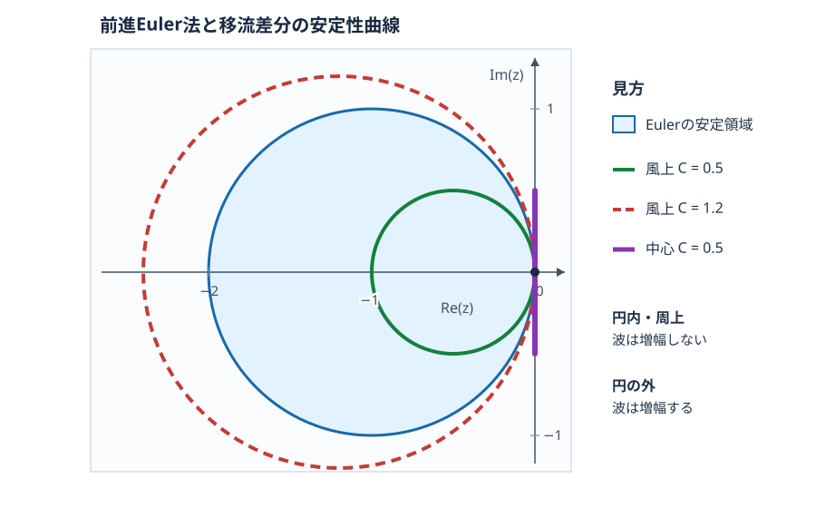

::: {.course-position}
任意・発展資料
:::

[N01の授業](../lessons/N01.qmd)では，右向きの移流を「風上差分＋前進Euler」で計算するとCFL数が1以下で安定し，「中心差分＋前進Euler」では振動が育つことを観察しました．
ここでは，一つひとつの波が時間更新で何倍になるかを計算し，その結論を証明します．
この方法を *von Neumann（フォン・ノイマン）安定性解析* と呼びます．

## 移流方程式の解はどう動くか {#exact-solution}

一定速度$c$の1次元線形移流方程式は

$$
\frac{\partial u}{\partial t}+c\frac{\partial u}{\partial x}=0
$$

です．
初期値を$u_0(x)$とすると，厳密解は$u(x,t)=u_0(x-ct)$です．
実際，$\xi=x-ct$として微分すると

$$
\frac{\partial u}{\partial t}=-c\,u_0'(\xi),\qquad
\frac{\partial u}{\partial x}=u_0'(\xi)
$$

なので，二つの項の和は0になります．
$c>0$なら分布は形を変えず右へ，$c<0$なら左へ移動します．
特に一つの波$u_0(x)=e^{\mathrm{i}kx}$を入れると

$$
u(x,t)=e^{\mathrm{i}k(x-ct)}=e^{-\mathrm{i}kct}e^{\mathrm{i}kx}
$$

です．
$\mathrm{i}^2=-1$であり，$|e^{-\mathrm{i}kct}|=1$です．
つまり，**厳密な移流では波の高さは変わらず，位置を表す位相だけが変わります**．

## 波の増幅率が安定性を決める理由 {#fourier-proof}

証明を明確にするため，まず$N\ge3$の等間隔の**周期格子**を考えます．
格子点を$x_j=j\Delta x$（$j=0,\ldots,N-1$），周期長を$L=N\Delta x$，時刻を$t_n=n\Delta t$とします．
任意の格子上の値は，次の$N$個の波の和で表せます．

$$
u_j^n=\sum_{m=0}^{N-1} A_m^n e^{\mathrm{i}j\theta_m},\qquad
\theta_m=\frac{2\pi m}{N}.
$$

$m$が波の番号，$A_m^n$が時刻$n$におけるその波の係数です．
複素数を使いますが，実数値の初期値から計算した結果は実数値になります．
係数は

$$
A_m^n=\frac{1}{N}\sum_{j=0}^{N-1}u_j^n e^{-\mathrm{i}j\theta_m}
$$

と計算できます．
線形で係数が一定の差分式では，波を一つ入れると同じ波のまま係数だけが変わります．
したがって各$m$について

$$
A_m^{n+1}=G(\theta_m)A_m^n,
\qquad A_m^n=G(\theta_m)^n A_m^0
$$

となります．
$G$を**増幅率**と呼びます．
$|G|<1$ならその波は減衰し，$|G|=1$なら高さを保ち，$|G|>1$なら繰り返すほど増えます．

この判定が「任意の初期値」に使える理由は，波同士の直交性です．
異なる番号$m,\ell$の波について，有限の等比数列の和を計算すると

$$
\sum_{j=0}^{N-1}e^{\mathrm{i}j(\theta_m-\theta_\ell)}
=\begin{cases}
N & (m=\ell),\\
0 & (m\ne\ell)
\end{cases}
$$

です．
$m\ne\ell$では比$r=e^{\mathrm{i}(\theta_m-\theta_\ell)}$が$r\ne1$かつ$r^N=1$を満たすため，和$(1-r^N)/(1-r)$は0です．
この直交性を$|u_j^n|^2$の和に使うと，交差する項が消え，離散Fourier変換のParsevalの等式を得ます．

$$
\sum_{j=0}^{N-1}|u_j^n|^2
=N\sum_{m=0}^{N-1}|A_m^n|^2
=N\sum_{m=0}^{N-1}|G(\theta_m)|^{2n}|A_m^0|^2.
$$

全波数で$|G|\le1$なら，右辺は初期時刻の値以下です．
逆に，ある波数で$|G|>1$なら，その波だけを初期値に選ぶと大きさは毎ステップ増えます．
したがって，**この周期格子上で2乗和が毎ステップ増えないための必要十分条件は，全波数で$|G|\le1$**です．

以下では$\theta=k\Delta x$と略記し，一つの波

$$
u_j^n=A_n e^{\mathrm{i}j\theta}
$$

を各更新式へ代入します．
隣の格子点では

$$
u_{j-1}^n=A_n e^{\mathrm{i}j\theta}e^{-\mathrm{i}\theta},\qquad
u_{j+1}^n=A_n e^{\mathrm{i}j\theta}e^{\mathrm{i}\theta}
$$

です．
この指数の符号が，左右どちらの点を使うかを示します．

## 右向きの流れ：風上差分＋前進Euler {#upwind}

$c>0$では左側が風上です．
[N01の更新式](../lessons/N01.qmd#upwind-euler)は

$$
u_j^{n+1}=u_j^n-C(u_j^n-u_{j-1}^n),\qquad
C=\frac{c\Delta t}{\Delta x}>0
$$

です．
$C$は1ステップで進む距離$c\Delta t$を格子幅で割ったCFL数（Courant数）です．
波を代入すると

$$
A_{n+1}e^{\mathrm{i}j\theta}
=A_ne^{\mathrm{i}j\theta}
-C\left(A_ne^{\mathrm{i}j\theta}-A_ne^{\mathrm{i}j\theta}e^{-\mathrm{i}\theta}\right).
$$

共通の$A_ne^{\mathrm{i}j\theta}$を取り出せば

$$
G_{\mathrm{up}}=\frac{A_{n+1}}{A_n}
=1-C(1-e^{-\mathrm{i}\theta})
=1-C+C\cos\theta-\mathrm{i}C\sin\theta.
$$

最後の等号ではEulerの公式$e^{-\mathrm{i}\theta}=\cos\theta-\mathrm{i}\sin\theta$を使いました．
複素数の絶対値は「実部の2乗＋虚部の2乗」の平方根なので，

$$
\begin{aligned}
|G_{\mathrm{up}}|^2
&=(1-C+C\cos\theta)^2+C^2\sin^2\theta\\
&=(1-C)^2+2C(1-C)\cos\theta+C^2\\
&=1-2C(1-C)(1-\cos\theta)\\
&=1-4C(1-C)\sin^2(\theta/2).
\end{aligned}
$$

2行目では$\cos^2\theta+\sin^2\theta=1$，最後は$1-\cos\theta=2\sin^2(\theta/2)$を使いました．

**$0\le C\le1$なら**$C(1-C)\ge0$であり，$\sin^2(\theta/2)\ge0$です．
よって全波数で$|G_{\mathrm{up}}|^2\le1$となり，安定です．
**$C>1$なら**$C(1-C)<0$です．
$\theta\ne0$の波で$|G_{\mathrm{up}}|^2>1$となるため，不安定です．
したがって正の速度での安定条件は

$$
0\le\frac{c\Delta t}{\Delta x}\le1.
$$

同じ条件を更新式からも確かめられます．

$$
u_j^{n+1}=(1-C)u_j^n+C u_{j-1}^n.
$$

$0\le C\le1$なら二つの係数は非負で和が1です．
更新値は現在値と左隣の重み付き平均になり，両者の範囲を飛び越えません．
更新を繰り返しても同じことが成り立つので，固定した流入値が初期値の範囲内なら，すべての新しい値もその範囲内です．
この見方は，周期格子だけでなくN01の流入境界を含む値の範囲を考える際にも役立ちます．

## 左向きの流れ：風上を右側へ変える {#negative-speed}

$c<0$では右側が風上です．
この場合は前進差分$u_{j+1}^n-u_j^n$を使います．
符号付きの$C=c\Delta t/\Delta x<0$を用いると

$$
u_j^{n+1}=u_j^n-C(u_{j+1}^n-u_j^n).
$$

上と同じように波を代入すると

$$
\begin{aligned}
G_{\mathrm{left}}&=1-C(e^{\mathrm{i}\theta}-1)
=1+C-C\cos\theta-\mathrm{i}C\sin\theta,\\
|G_{\mathrm{left}}|^2
&=(1+C-C\cos\theta)^2+C^2\sin^2\theta\\
&=1+2C(1+C)(1-\cos\theta).
\end{aligned}
$$

$-1\le C\le0$では$C(1+C)\le0$なので，全波数で$|G_{\mathrm{left}}|\le1$です．
$C<-1$では非定数の波が増幅します．
したがって，速度の向きに合わせて風上差分を選んだ場合，両方向をまとめた条件は

$$
\frac{|c|\Delta t}{\Delta x}\le1.
$$

差分の向きだけを固定して速度を反転させると，この結論は成り立ちません．
使う隣接点も流れの向きに合わせて変えます．

## 中心差分＋前進Eulerはなぜ不安定か {#centered}

[N01の比較方法](../lessons/N01.qmd#centered-euler)では，空間微分に左右対称の中心差分を使います．

$$
u_j^{n+1}=u_j^n-\frac{C}{2}(u_{j+1}^n-u_{j-1}^n).
$$

波を代入して共通の$A_ne^{\mathrm{i}j\theta}$で割ると

$$
\begin{aligned}
G_{\mathrm{cen}}
&=1-\frac{C}{2}(e^{\mathrm{i}\theta}-e^{-\mathrm{i}\theta})\\
&=1-\mathrm{i}C\sin\theta,
\end{aligned}
$$

です．
ここでは$e^{\mathrm{i}\theta}-e^{-\mathrm{i}\theta}=2\mathrm{i}\sin\theta$を使いました．
したがって

$$
|G_{\mathrm{cen}}|^2=1+C^2\sin^2\theta.
$$

$C\ne0$で$\sin\theta\ne0$なら，右辺は必ず1より大きくなります．
たとえば$\theta=\pi/2$で$|G_{\mathrm{cen}}|=\sqrt{1+C^2}>1$です．
**どれほど小さい正の時間刻みでも，増幅する波がある**ため，中心差分＋前進Eulerは移流方程式に対して無条件に不安定です．
$\theta=0,\pi$など一部の波では$|G|=1$ですが，すべての波に対する条件は満たしません．

## 安定性曲線を複素平面で読む {#stability-curves}

ここまでの$G(\theta)$は，「空間差分」と「時間更新」を組み合わせた1ステップの増幅率でした．
時間積分法の安定性曲線を描くには，空間差分だけを先に行い，各波の振幅が従う常微分方程式

$$
\frac{dA}{dt}=\lambda(\theta)A
$$

を考えます．
$\lambda$は一般に複素数で，実部は波の減衰や増大，虚部は波の移動に関係します．
$z=\lambda\Delta t$とおくと，前進Euler法は

$$
A_{n+1}=A_n+\Delta t\lambda A_n
=R_{\mathrm{E}}(z)A_n,\qquad R_{\mathrm{E}}(z)=1+z
$$

です．
したがって，前進Euler法の**安定領域**は$|R_{\mathrm{E}}(z)|\le1$を満たす点の集合です．
$z=x+\mathrm{i}y$と書けば

$$
|1+z|^2=(1+x)^2+y^2\le1.
$$

複素平面では，中心$(-1,0)$・半径1の円の内部と周上です．
その**境界**$|1+z|=1$を時間積分法の安定性曲線と呼びます．
円の外にある波は，前進Euler法で1ステップごとに増幅します．

正の速度に対する風上差分では，空間だけを離散化した式$du_j/dt=-c(u_j-u_{j-1})/\Delta x$へ波を代入すると$\lambda_{\mathrm{up}}=-c(1-e^{-\mathrm{i}\theta})/\Delta x$です．
したがって

$$
z_{\mathrm{up}}(\theta)
=-C(1-e^{-\mathrm{i}\theta})
=C(e^{-\mathrm{i}\theta}-1),\qquad
|z_{\mathrm{up}}+C|=C
$$

です．
$\theta$を変えると，$z_{\mathrm{up}}$は中心$(-C,0)$・半径$C$の円を描きます．
前進Euler法の安定円と同じく原点を通り，左端は$-2C$です．
この円が安定領域の中に全部入るのは$0\le C\le1$のときです．
$C=1$では二つの円が一致し，$C>1$では風上差分の円の一部が安定領域からはみ出します．

中心差分の半離散式$du_j/dt=-c(u_{j+1}-u_{j-1})/(2\Delta x)$では$\lambda_{\mathrm{cen}}=-\mathrm{i}c\sin\theta/\Delta x$なので，

$$
z_{\mathrm{cen}}(\theta)=-\mathrm{i}C\sin\theta
$$

となり，曲線は虚軸上の線分です．
前進Euler法の安定円は虚軸と原点でしか交わらないため，$C\ne0$なら原点以外の波は円の外側にあります．

{fig-alt="複素平面の横軸が実部，縦軸が虚部．前進Eulerの安定領域はマイナス1を中心とする円内．風上差分のCFL数0.5の円は領域内，1.2の円は一部が領域外．中心差分のCFL数0.5の線分は虚軸上にあり，原点以外は領域外．"}

図の**青い領域**は時間積分法の許す範囲，**色付きの線**は空間差分が各波数から作る$z$の軌跡です．
両者を重ねると，前節で計算した$G=1+z$の安定条件を図として読めます．
安定領域は時間積分法を変えると変わります．
たとえばRK2やRK4の$R(z)$と安定領域は[時間積分の発展資料](numerical-schemes.qmd#stability)で確認できます．

## N01の条件で数字を確かめる {#example}

N01の標準条件と同じ$C=0.5$で，$\theta=\pi/2$という波を考えます．
厳密解の1ステップの増幅率は$e^{-\mathrm{i}C\theta}$で，絶対値は1です．

| 方法 | 1ステップの$G$ | 振幅の倍率$|G|$ |
|---|---|---:|
| 厳密な移流 | $e^{-\mathrm{i}C\theta}$ | $1$ |
| 風上差分＋前進Euler | $0.5-0.5\mathrm{i}$ | 約$0.707$ |
| 中心差分＋前進Euler | $1-0.5\mathrm{i}$ | 約$1.118$ |

40ステップ後の振幅は，風上差分では初期値の約$0.707^{40}\approx9.5\times10^{-7}$倍，中心差分では約$1.118^{40}\approx87$倍です．
これは一つの波についての比較です．
N01の矩形波は多くの波の和なので，計算結果にはそれぞれの増減が重なって現れます．

風上差分で$|G|<1$となる波があることは，**安定でも波形がなまる**ことを意味します．
これが数値拡散です．
ただし$C=1$では$G_{\mathrm{up}}=e^{-\mathrm{i}\theta}$となり，周期格子上では各波が減衰せず1ステップにちょうど1格子点進みます．

## 証明の適用範囲 {#scope}

von Neumann解析の「全波数で$|G|\le1$」という証明は，ここでは一定速度・等間隔の**周期格子**に対して行いました．
N01の計算には固定流入・流出境界があります．
波の計算だけで，その境界処理を含む全体の安定性まで証明したわけではありません．
一方，$0\le C\le1$の風上更新が重み付き平均になることから，N01で使う固定流入値も含めた最大値・最小値の範囲を保つことが分かります．

また，**安定性と精度は別**です．
$|G|\le1$は波が増えない条件であり，正しい速度で進むか，振幅が正確に保たれるかは別に確かめます．
時間積分法を変えたときの安定性と誤差は[時間積分の発展資料](numerical-schemes.qmd)で扱います．

さらに学ぶ場合は，Kajishima・Taira, *Computational Fluid Dynamics: Incompressible Turbulent Flows* (Springer, 2017), §2.5.2「von Neumann Analysis」と§2.5.3「Stability of the Discrete Advection Equation」を参照してください．
