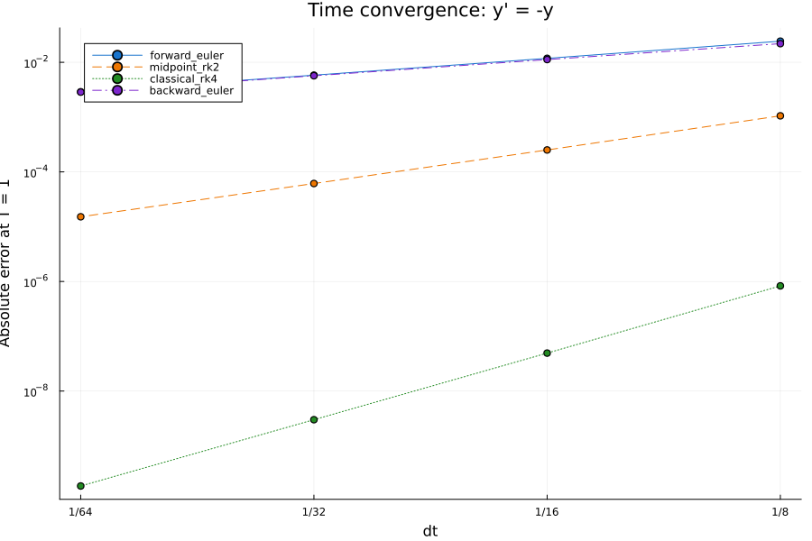
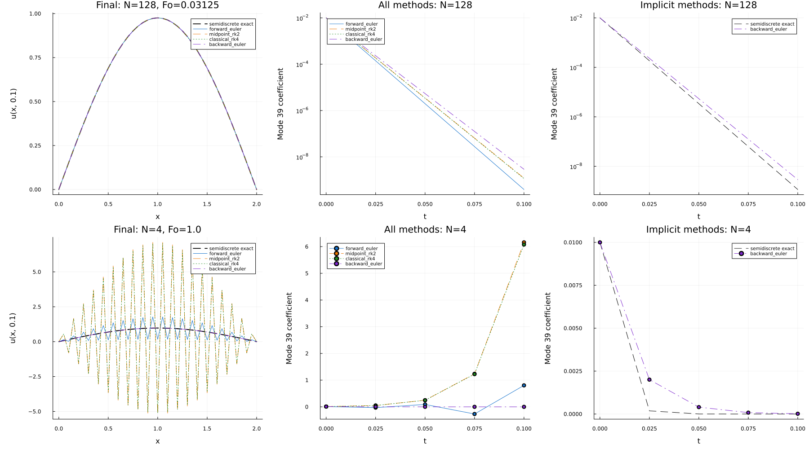
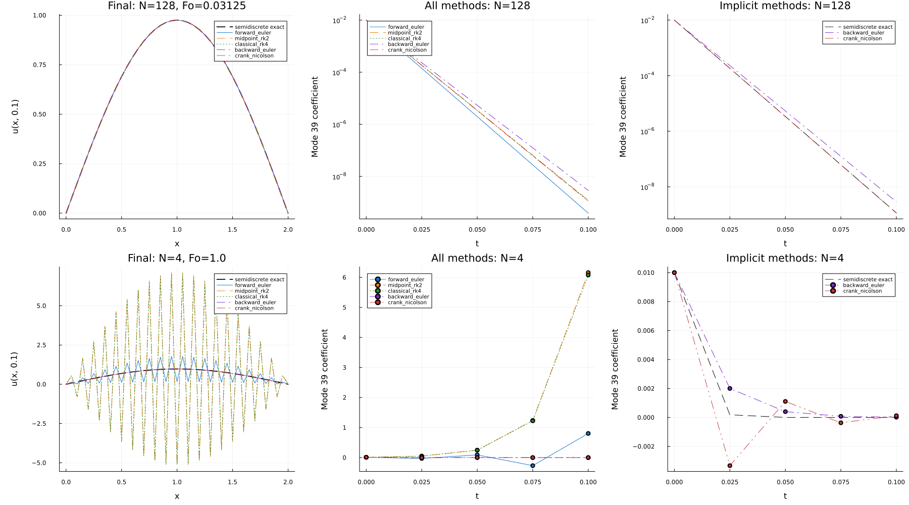

B3向けに，時間刻みを変えたときの誤差と，拡散問題での安定性を比較します．
**2026年度は任意教材です．**
[N03授業](../lessons/N03.qmd)の基準実装は前進Euler＋空間2次中心差分です．
既存の[N03課題](../assignments/N03.qmd)の実装3箇所，自作テスト2つ，公式4出力，完了条件はそのままです．
この比較は通常のテスト・進捗判定・公式提出物に含めません．

## 常微分方程式で時間誤差を分ける {#time-error}

まず空間差分を使わず，$y'=-y$，$y(0)=1$を最終時刻$T=1$まで解きます．
厳密解は$y(t)=e^{-t}$です．
ステップ数を$N=8,16,32,64$とし，$\Delta t=T/N$で終点を揃えます．
誤差と観測次数は
$$
\begin{aligned}
E_N&=|y_N-e^{-1}|,\\
p_N&=\log_2(E_N/E_{2N}).
\end{aligned}
$$
で求めます．
$p$次精度なら，十分小さな刻みで誤差は概ね$C\Delta t^p$となり，刻みを半分にすると約$2^p$分の1になります．
ここでは空間誤差がなく，時間積分器の違いだけを観察できます．

### 前進Eulerと陽的中点RK2

$y'=f(y,t)$に対し，前進Eulerは旧時刻の傾きを使います．
$$
y_{n+1}=y_n+\Delta t f(y_n,t_n)
$$
陽的中点法のRK2は，中点の状態を予測し，その時刻の傾きで1ステップ全体を進めます．
$$
\begin{aligned}
k_1&=f(y_n,t_n),\\
k_2&=f\left(y_n+\tfrac{\Delta t}{2}k_1,t_n+\tfrac{\Delta t}{2}\right),\\
y_{n+1}&=y_n+\Delta t k_2.
\end{aligned}
$$
右辺APIは`f(y,t)`です．
学生が実装するのは[`run.jl`](https://github.com/t2lab-it/thermofluid-exercise-student-2026/blob/main/examples/time-integration/run.jl)の`rk2_step(f,y,t,dt)`のTODO 1箇所です．
スカラーと配列の両方に対応させ，入力配列を変更せず，返す配列も入力から独立させます．
入力検証と`rhs(f,y,t)`は配布済みです．

### 古典的RK4の4段

古典的RK4は，始点，中点2回，終点で傾きを評価します．
$$
\begin{aligned}
k_1&=f(y_n,t_n),\\
k_2&=f\left(y_n+\tfrac{\Delta t}{2}k_1,t_n+\tfrac{\Delta t}{2}\right),\\
k_3&=f\left(y_n+\tfrac{\Delta t}{2}k_2,t_n+\tfrac{\Delta t}{2}\right),\\
k_4&=f(y_n+\Delta t k_3,t_n+\Delta t),\\
y_{n+1}&=y_n+\tfrac{\Delta t}{6}(k_1+2k_2+2k_3+k_4).
\end{aligned}
$$
各段の状態を変えて傾きを組み合わせることで，滑らかな解に対する大域誤差が4次になります．
RK4は[`provided_methods.jl`](https://github.com/t2lab-it/thermofluid-exercise-student-2026/blob/main/examples/time-integration/provided_methods.jl)の配布実装を読み，式と対応づけます．

狭い画面では表・数式・コードを横へスクロールして読めます．

::: {.time-integration-table tabindex="0" role="region" aria-label="時間積分法の計算量比較"}

| 手法 | 時間次数 | $N$ステップ中のRHS評価 | 分解 | 線形求解 |
|---|---:|---:|---:|---:|
| 前進Euler | 1 | $N$ | 0 | 0 |
| 陽的中点RK2 | 2 | $2N$ | 0 | 0 |
| 古典的RK4 | 4 | $4N$ | 0 | 0 |
| 後退Euler（線形・固定刻み） | 1 | 0 | 1 | $N$ |

:::

後退Eulerの仕組みは[後半](#backward-euler)で説明します．
ここで数えるのは積分中の処理であり，誤差診断のための計算を含めません．
RHS評価1回と線形求解1回の負担は同じではなく，問題の大きさや行列構造にも依存します．
実時間は実行環境に左右されるため，採点基準にしません．

## 空間差分から連立ODEへ {#semidiscrete}

拡散方程式$u_t=D u_{xx}$の空間だけを2次中心差分にすると，内部点で
$$
\frac{du_j}{dt}=\frac{D}{\Delta x^2}(u_{j-1}-2u_j+u_{j+1})
$$
となります．
固定端が0なら，内部の値を並べたベクトル$\boldsymbol u$は連立ODE
$$
\frac{d\boldsymbol u}{dt}=A\boldsymbol u,\qquad
A=\frac{D}{\Delta x^2}\operatorname{tridiag}(1,-2,1)
$$
に従います．
このように空間を離散化して時間を連続のまま残すことを半離散化と呼びます．
先ほどの時間積分器を同じ$A$へ適用すれば，時間手法だけを比較できます．

### 実験Bの共通条件

::: {.time-integration-table tabindex="0" role="region" aria-label="実験Bの共通条件"}

| 項目 | 条件 |
|---|---|
| 領域と係数 | $[0,2]$，$D=0.1$ |
| 格子と境界 | 両端を含む41点，$\Delta x=0.05$，両端Dirichlet 0 |
| 未知数と空間差分 | 内部39点，空間2次中心差分 |
| 初期値 | $\phi_1+0.01\phi_{39}$，$\phi_k(j)=\sin(k\pi j/40)$，$j=0,\ldots,40$ |
| 最終時刻 | $T=0.1$ |
| 細かい刻み | $N=128$，$\Delta t=T/N$，$\mathrm{Fo}=0.03125$ |
| 粗い刻み | $N=4$，$\Delta t=T/N$，$\mathrm{Fo}=1$ |

:::

同じ$N$では，全手法で格子・初期値・刻みを揃えます．
配布例は刻みを安定上限へ自動縮小しません．
N03の標準計算とは格子と初期値が異なる独立実験です．

時間誤差の比較基準は，同じ半離散系の厳密解
$$
\begin{aligned}
\lambda_k&=-\frac{4D}{\Delta x^2}\sin^2\left(\frac{k\pi}{80}\right),\\
\boldsymbol u_*(t)&=e^{\lambda_1t}\boldsymbol\phi_1+0.01e^{\lambda_{39}t}\boldsymbol\phi_{39}
\end{aligned}
$$
です．
連続PDEの厳密解と比べると空間誤差が混ざるため，この時間比較の参照には使いません．
最終分布，$\max_j|u_j(T)-u_{*,j}(T)|$，高周波モード39の係数履歴を読みます．

## 拡散の安定性と高周波 {#stability}

固有モードごとには$y'=\lambda y$，$\lambda<0$の減衰問題です．
$z=\lambda\Delta t$とすると，1ステップの増幅率は次の形になります．

::: {.time-integration-table tabindex="0" role="region" aria-label="時間積分法の増幅率比較"}

| 手法 | 増幅率 $R(z)$ |
|---|---|
| 前進Euler | $1+z$ |
| 陽的中点RK2 | $1+z+z^2/2$ |
| 古典的RK4 | $1+z+z^2/2+z^3/6+z^4/24$ |
| 後退Euler | $1/(1-z)$ |

:::

$|R(z)|\le1$ならそのモードは増幅しません．
前進Eulerの拡散で使う$\mathrm{Fo}=D\Delta t/\Delta x^2\le1/2$は[N03の安定条件](../lessons/N03.qmd#stability)です．
RK2も負の実軸で$-2\le z\le0$が安定範囲であり，次数が高いだけで刻み制約がなくなるわけではありません．
RK4は負の実軸の安定範囲を広げますが，実験Bの粗い刻みでは高周波の$z$が約$-4$となり，この範囲も超えます．
初期値の小さな高周波成分が，全体の分布へ大きく現れる様子を確認します．
$N=4$で陽解法の高周波が有限のまま増幅する結果は，意図した比較結果です．
非有限値で計算が停止する場合とは区別してください．

## 後退Eulerの連立方程式と計算量 {#backward-euler}

後退Eulerは新時刻の傾きを使います．
$$
\begin{aligned}
\boldsymbol u^{n+1}&=\boldsymbol u^n+\Delta t A\boldsymbol u^{n+1},\\
(I-\Delta t A)\boldsymbol u^{n+1}&=\boldsymbol u^n.
\end{aligned}
$$
行列の右辺には既知の旧値を置き，未知の新値を線形方程式の求解で得ます．
Juliaでは`(I-dt*A) \ u_old`に対応し，逆行列を作りません．
配布実装は固定dtの実験ごとに係数行列を1回分解し，各ステップでその分解を再利用して解きます．
1ステップごとに分解し直す必要はありません．
行列組立てと線形求解は配布済みで，学生の必須実装にはしません．

この一次元問題の行列は三重対角なので，構造を利用する直接法の分解・求解は未知数の数に比例する計算量になります．
配布例では式との対応を読みやすくするため，密行列に変換してLU分解します．
密行列では分解が概ね未知数の3乗，求解が2乗となり，単なるRHS評価より重い処理になり得ます．
格子を細かくすると陽解法では安定性のためのステップ数も増えるため，1ステップの負担と総ステップ数を一緒に考えます．

負の実数$z$に対し後退Eulerの$|R(z)|$は1以下なので，この線形拡散問題では刻みによらず安定です．
ただし時間は1次精度であり，大きな刻みでは減衰の速さを正確に表せません．
**安定性は誤差が小さいことを保証しません．**
細かい刻みの結果と最大絶対誤差も比較してください．

## 取得・実装・実行 {#try-example}

### 新規フォルダだけを取得する {#get-example}

学生リポジトリrootで，既存の`upstream`が授業の学生配布元を指すことを[共通の更新案内](../guides/workflow.qmd#material-updates)から確認します．
次のブロック全体をfishへ貼り付けます．
全体merge・課題branch切替・package環境更新は取得条件にしません．

```{.fish #time-integration-fetch}
function acquire_time_integration
    set -l target examples/time-integration
    set -l root (git rev-parse --show-toplevel)
    or return 1
    if test (pwd -P) != "$root"
        echo '学生リポジトリのrootで実行してください．' >&2
        return 1
    end
    if test -e "$target"; or test -L "$target"
        echo '同名パスがあります．上書きせず中断します．' >&2
        return 1
    end
    if test -n "$(git ls-files -- "$target")"
        echo 'indexに同名パスがあります．差分を確認してください．' >&2
        return 1
    end
    if test -L examples
        echo 'examplesのリンク先へは取得しません．' >&2
        return 1
    end
    if test -e examples; and not test -d examples
        echo 'examplesの種類を確認してください．' >&2
        return 1
    end
    git fetch --no-tags upstream main
    or return 1
    if test "$(git cat-file -t FETCH_HEAD:$target)" != tree
        echo '配布元に対象フォルダがありません．' >&2
        return 1
    end
    git restore --source=FETCH_HEAD --worktree -- "$target"
end
acquire_time_integration
```

既存の課題・学習ログ・進捗ファイルとindexを保ち，新規フォルダだけがworking treeに未追跡で加わります．
`git status --short`と`git diff --cached`で元の作業を確認します．
同名のフォルダ・ファイル・リンクがあれば，追跡・未追跡を問わず中断します．
削除済みでもindexに登録が残る場合は止まります．
編集済みの例は差分を確認するか，リポジトリ外の別の保存先で比較してください．
これは初回の選択取得専用であり，将来の全体mergeに伴う競合を解消する手順ではありません．
通常の課題開始・更新は[既存workflow](../guides/workflow.qmd)を使い，更新前にこのフォルダも含めて差分を確認します．

### RK2を実装して検査する

[`README`](https://github.com/t2lab-it/thermofluid-exercise-student-2026/blob/main/examples/time-integration/README.md)のAPI条件を読み，`run.jl`の`rk2_step(f,y,t,dt)`だけを実装します．
未取得の旧配布状態にはこの例がなく，取得直後はRK2が未実装です．
未実装で次のテスト・実行が失敗するのは正しく，仮の値で通してはいけません．
完成後は，学生リポジトリrootで次の順に実行します．

```fish
julia --project=. examples/time-integration/tests.jl
julia --project=. examples/time-integration/run.jl
```

既存のJulia環境を使います．
`scratch/time-integration/`へ`time-convergence.png`，`diffusion-comparison.png`，`summary.toml`の3点を保存します．
includeだけでは計算・保存・進捗更新をしません．
不正入力は変更前に`ArgumentError`となり，計算・描画・保存・反映途中の失敗では旧3成果物と無関係なファイルを保ちます．
任意例のテストは通常の`Pkg.test()`やN03の進捗判定から独立しています．

### 図と数値を照合する {#read-results}

時間収束図の両対数軸では，傾き1・2・4・1と対応する誤差の減り方を読みます．
拡散比較図は上段が$N=128$，下段が$N=4$で，左から最終分布，全手法の高周波係数，陰解法の高周波係数です．
色と線種で手法を見分け，拡大した図の凡例も確認してください．
陽解法の増幅で縦軸が広がる場合は，右列で陰解法の小さな係数を読みます．
以下は同じ配布例を完成させた基準結果です．
図を選ぶと拡大できます．
自分の図を生成し，[基準のsummary.toml](../assets/time-integration-reference/summary.toml)と数値も照合します．

{fig-alt="横軸dt，縦軸T=1での絶対誤差を両対数で示す．前進Eulerと後退Eulerは1次，陽的中点RK2は2次，古典的RK4は4次の傾きで誤差が減る"}

{fig-alt="上段はN=128，下段はN=4．各段で左から最終分布，全手法の高周波係数履歴，陰解法の係数履歴．粗い刻みの陽解法は有限のまま増幅し，後退Eulerは減衰する"}

次の例は学生rootでJuliaを起動して実行できます．

```{.julia #time-integration-summary}
using TOML
summary = TOML.parsefile("scratch/time-integration/summary.toml")
@assert summary["schema_version"] == 1
@assert summary["example_id"] == "time-integration"
for row in summary["time_convergence"]
    println(row["method"], ": orders = ", row["orders"])
    println("  N=64 cost = ", last(row["cost"]))
end
```

`time_convergence`に誤差・次数・積分中の計算回数が，`diffusion`に最終分布・最大絶対誤差・高周波係数履歴が入っています．
完了の目安は，RK2の検査が通り，4手法の次数，粗い刻みの増幅，後退Eulerの安定性と残る誤差を図と数値から説明できることです．
今年度のN03提出条件へは追加しません．

## 任意：Crank–Nicolson {#crank-nicolson}

旧時刻と新時刻の傾きの平均を使うと，線形問題では
$$
(I-\tfrac{\Delta t}{2}A)\boldsymbol u^{n+1}
=(I+\tfrac{\Delta t}{2}A)\boldsymbol u^n
$$
を解きます．
Crank–Nicolsonは時間2次で，この線形拡散問題では無条件安定です．
ただし増幅率$R(z)=(1+z/2)/(1-z/2)$は$z<-2$で負になり，大刻みではモード係数の符号が交代します．
$|R(z)|<1$でも符号は変わるため，減衰しながらの振動を振幅の発散と区別します．
配布コードと追加図は次のコマンドで比較できます．

```fish
julia --project=. examples/time-integration/run.jl scratch/time-integration-cn --cn
```

右下の陰解法専用パネルで符号交代を確認し，後退Eulerの強い高周波減衰と比べてください．
[CNを含む数値](../assets/time-integration-reference/summary-cn.toml)でも係数の絶対値と符号を確認できます．

{fig-alt="必須4手法にCrank–Nicolsonを加えた比較．右下でCNの高周波係数は符号を交互に変えながら減衰し，後退Eulerは符号を変えずに強く減衰する"}

## さらに学ぶ空間・時間の手法

空間4次中心差分は，内部点で
$$
u_{xx}(x_j)\approx\frac{-u_{j+2}+16u_{j+1}-30u_j+16u_{j-1}-u_{j-2}}{12\Delta x^2}
$$
と近似します．
滑らかな関数では空間誤差を減らせますが，端の処理と時間積分の安定性も合わせて設計します．
Lax–Wendroff法は，移流方程式の時間Taylor展開に方程式を代入して空間微分へ置き換える，時間と空間を組み合わせた2次の方法です．
非線形移流や急な勾配では，高次化だけでは非物理的な振動を抑えられません．
SSPRKは空間離散化が持つ安定性を時間側で保つ条件を，MUSCL・TVD・WENOは空間再構成や振動を抑える考え方を学ぶ入口です．
導出・実装は以下の参考資料へ進み，今回のN03や比較例の実装範囲には加えません．

- [東京大学：常微分方程式の数値解法](https://www.den.t.u-tokyo.ac.jp/ad_prog/ode/)：Euler・中点法・RK4の導入．
- [Cambridge：PDE stability](https://www.damtp.cam.ac.uk/user/hf323/M21-II-NA/demos/pde_stability/pde_stability.html)：拡散の陽EulerとCrank–Nicolsonの比較．
- [Oxford：Numerical solution of PDEs](https://people.maths.ox.ac.uk/suli/lecture_notes.pdf)：theta法と安定性・精度．
- [Clawpack：1D advection](https://www.clawpack.org/gallery/_static/apps/notebooks/classic/advection_1d/advection_1d.html)：移流手法と振動の比較．
- [Shu：ENO and WENO schemes](https://ntrs.nasa.gov/api/citations/19980007543/downloads/19980007543.pdf)：TVD・SSPRK・MUSCL・ENO/WENOの先の学習．
