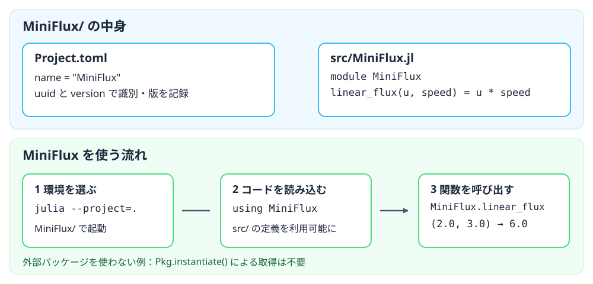

::: {.course-position}
参照・Julia環境
:::

このページでは，Juliaのパッケージの役割，最小構成，環境への準備とコードからの読み込みを説明します．
授業で配布する環境の選択と復元の手順は，[Julia環境のしくみ](julia-environment.qmd)を参照してください．

## パッケージとは {#what-is-a-package}

**パッケージ**は，ほかのJuliaプログラムから使えるようにまとめたコードです．
中には関数などの部品が入っており，自分のプログラムから呼び出せます．
たとえば，計算結果を検査する処理が必要なとき，毎回その処理を一から書く代わりに，Juliaに付属する`Test`パッケージを使えます．

```julia
using Test
@test 1 + 1 == 2
```

1行目で`Test`を読み込み，2行目でそのテスト機能を使っています．
`@test`は右側の条件が成り立つかを確かめる書き方です．
パッケージはJuliaに付属するものだけではありません．
別に配布されているものも，授業後半の`ThermofluidExercise`のように自分たちで作るものもあります．
自分の課題コードを実行するだけならパッケージにする必要はありませんが，複数の課題から同じ処理を使いたいときは，パッケージにまとめる方法があります．
パッケージと，コード中の名前を整理する**モジュール**の違いは，[N05の説明](../lessons/N05.qmd#module-scope)で扱います．

### 自分で作るパッケージの最小構成 {#minimal-package}

例として，流束を計算する関数を`MiniFlux`というパッケージにまとめます．
最小の例では，次の2ファイルを用意します．

```text
MiniFlux/                  ← パッケージのルート
├── Project.toml           ← 名前・識別子・版などを記録
└── src/
    └── MiniFlux.jl        ← 実際に動くJuliaコードの入口
```

ルートの`Project.toml`には，パッケージ名を`name`，同名の別パッケージと区別する識別子を`uuid`，版を`version`として書きます．
次のUUIDは例示用です．
自分で新しく作るときは，Juliaで`using UUIDs; uuid4()`を実行するなどして固有の値を生成します．

```toml
name = "MiniFlux"
uuid = "5e95ebd2-99da-45ab-88f2-cdf16c64dd91"
version = "0.1.0"
```

`src/MiniFlux.jl`には，同じ名前の`module MiniFlux ... end`を置き，中に再利用したい処理を書きます．
ここでは関数を一つだけ定義します．

```julia
module MiniFlux
linear_flux(u, speed) = u * speed
end
```

`Project.toml`は「何というパッケージか」をJuliaに伝え，`src/MiniFlux.jl`は「読み込んだら何が使えるか」を定義します．
この例では外部パッケージを使わないため，依存関係を列挙する`[deps]`はありません．
`Manifest.toml`はパッケージの定義に必須ではありませんが，依存パッケージの具体的な版を記録し，同じ環境を復元するために使います．
機能が増えたらソースを複数ファイルに分けたり，`test/runtests.jl`に動作確認を置いたりできます．
授業の通常課題では，配布済みの環境ファイルと既存の`ThermofluidExercise`を使うため，この例のファイルを新しく作る必要はありません．
詳しくは[Pkg公式資料：パッケージの作成](https://pkgdocs.julialang.org/v1/creating-packages/)を参照してください．

### 環境の準備とパッケージの読み込み

先ほどの`MiniFlux`を使うときは，ターミナルで`MiniFlux/`へ移動し，`julia --project=.`でJuliaを起動します．
`--project=.`は，そのディレクトリの`Project.toml`を使う**環境の選択**です．
この時点では`src/MiniFlux.jl`のコードは読み込まれていません．
Juliaの画面で`using MiniFlux`を実行すると，`src/MiniFlux.jl`で定義した機能が読み込まれ，関数を使えるようになります．

```julia-repl
julia> using MiniFlux

julia> MiniFlux.linear_flux(2.0, 3.0)
6.0
```

`MiniFlux.linear_flux`のドットは，「`MiniFlux`の中の`linear_flux`」という意味です．
この例は`export`を使っていないので，パッケージ名を付けて呼び出します．
`import MiniFlux`でも同じ呼び出しができます．
`using`は`export`された名前も直接使えるようにしますが，この最小例には`export`がないため，ここでの使い方に違いはありません．
また，外部パッケージへの依存がないため，`MiniFlux`を試すだけならパッケージの取得や`Pkg.instantiate()`は不要です．

{fig-alt="上段はMiniFluxのProject.tomlに名前・UUID・版を記録し，src/MiniFlux.jlにモジュールとlinear_flux関数を定義する構成．下段はMiniFluxのルートでjulia --project=.を実行し，using MiniFluxで読み込み，MiniFlux.linear_flux(2.0, 3.0)が6.0を返す流れ．外部依存がないためPkg.instantiateによる取得は不要．"}

外部パッケージを使うプロジェクトでは，`Project.toml`の`[deps]`に必要なパッケージを記録します．
`Manifest.toml`があれば，解決済みの具体的な版も記録できます．
Julia付属の管理機能`Pkg`を使い，選択中の環境で`Pkg.instantiate()`を実行すると，不足する外部パッケージを手元に用意できます．
その後，コードの`using`や`import`でパッケージを**読み込み**ます．
`Pkg.instantiate()`は準備，`using`・`import`は読み込みであり，後者だけで未導入の外部パッケージは取得されません．
Juliaに付属する`Test`は，外部パッケージの取得なしで`using Test`と書けます．

授業の通常課題では，外部パッケージも使うため，準備の段階が一つ増えます．
学生リポジトリをcloneすると，課題コードと`Project.toml`・`Manifest.toml`という**環境の記録**を取得します．
これらのファイルは外部パッケージの本体ではありません．
選択した環境で`Pkg.instantiate()`を実行すると，記録をもとに不足する外部パッケージを用意します．
その後，課題コードの`using`や`import`が，実行中のJuliaへ必要なパッケージを読み込みます．
自作の`ThermofluidExercise`は，`MiniFlux`と同じくリポジトリ内の`src/`から読み込まれます．
