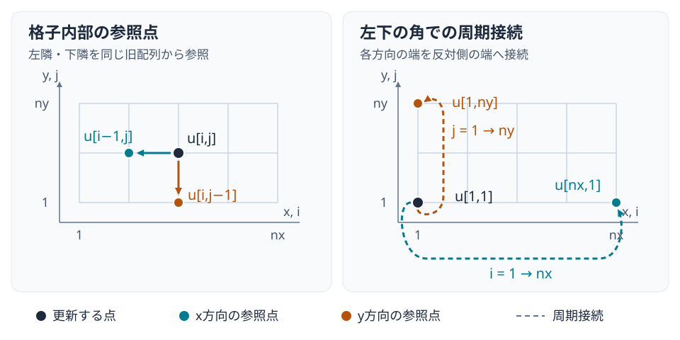

::: {.course-position}
第8回・授業 · 内容ID: N06
:::

## 周期長方形上の移流 {#problem-setup}

[N01](N01.qmd)で扱った一次元の移流を，x方向とy方向に広げます．
[N05の共通化](N05.qmd#helper-roles)を使うと，周期添字やバッファ検証を再利用できます．
各点に一つの無次元量$u$を持ち，非負の一定速度$(c_x,c_y)$で分布を運ぶ問題を考えます．
少なくとも一方の速度を正とし，方程式と領域を
$$
\frac{\partial u}{\partial t}+c_x\frac{\partial u}{\partial x}
+c_y\frac{\partial u}{\partial y}=0,
\qquad (x,y)\in[0,L_x)\times[0,L_y)
$$
とします．
両方向の周期終点を重複させず，$\Delta x=L_x/n_x$，$\Delta y=L_y/n_y$の格子を置きます．
周期的な初期分布$u_0(x,y)$に対する解析解は
$$
u_{\mathrm{exact}}(x,y,t)=u_0\bigl(\operatorname{mod}(x-c_xt,L_x),
\operatorname{mod}(y-c_yt,L_y)\bigr)
$$
です．
初期分布を平行移動した解析解と比べると，数値解の振幅の減少を数値拡散として読み取れます．
指定モード・格子・速度・保存時刻は[N06課題](../assignments/N06.qmd#problem-setup)にあります．

## 配列軸と周期端 {#grid}

Julia配列`u[i,j]`は座標`x[i],y[j]`に対応します．
第1添字がx方向，第2添字がy方向です．
座標は`x=(0:nx-1)*dx`，`y=(0:ny-1)*dy`で，周期終点の手前まで配置します．

{fig-alt="横軸がxと添字i，縦軸がyと添字jの非正方格子．左隣iマイナス1と下隣jマイナス1を参照し，iが1ならnx，jが1ならnyへ周期的に戻る"}

左端の左隣は`nx`，下端の下隣は`ny`です．
角でも二つの周期隣接点を同じ旧配列から読みます．
例えば`u[1,1]`の更新では，x方向の風上点を`u[nx,1]`，y方向の風上点を`u[1,ny]`として読みます．
非正方格子と非対称な値を使うと，x/yや`dx`/`dy`の取り違えを発見できます．

## 二方向の更新と合成CFL {#stability}

非負速度に対して，一次精度の風上差分を二方向に適用すると，更新式は
$$
u_{i,j}^{n+1}=u_{i,j}^n
-C_x(u_{i,j}^n-u_{i-1,j}^n)
-C_y(u_{i,j}^n-u_{i,j-1}^n),
\quad C_x=\frac{c_x\Delta t}{\Delta x},\quad C_y=\frac{c_y\Delta t}{\Delta y}.
$$

旧値の係数は`1-Cx-Cy`なので，安定条件は二方向の寄与を合わせた`Cx+Cy <= 1`です．
例えば`Cx=Cy=0.6`では，各方向は1以下でも，中央の旧値に掛かる係数は`-0.2`になります．
合成条件から求める刻み上限は
$$
\Delta t_{\max}=\frac{\mathrm{safety}}{c_x/\Delta x+c_y/\Delta y},
\qquad 0<\mathrm{safety}\le1.
$$

例えば`cx=1, cy=0.75, dx=0.5, dy=0.25, safety=0.8`では上限は`0.16`です．
この上限から，実際に使う時間刻みを保存時刻に合わせて決めます．
各ステップでは，二方向の寄与を同じ`u_old`から求め，全点の更新値を`u_new`へ書いてから，旧・新バッファを交換します．

## 時間更新と保存場 {#saved-fields}

ここでいう「場」は，全格子点の値をまとめた配列です．
二重バッファは，更新前と更新後の場を入れる二つの作業用配列です．
保存時刻の場は，その時刻の状態を後で調べるために残します．
同じ配列への参照だけを保存すると，バッファの再利用で過去の時刻の場も書き換わります．
数値配列のスナップショットは`copy`で独立させます．
参照だけを残す場合との違いは，[N01の配列の参照・コピー・変更](N01.qmd#array-reference-copy)の実行例で確認できます．
各保存区間で，安定刻み上限以下となるようにステップ数を切り上げ，区間長を等分する刻みに合わせます．
保存時刻に到達した場を保存します．

計算で場を保存し，保存場から診断値を求め，診断と場から図を作る構成を考えます．
色の範囲だけを変えるなら作図，診断量を追加するなら解析，移流速度を変えるなら計算からやり直します．
SHA-256は内容から求める識別値です．
解析・作図が参照したファイルを識別し，違う計算の結果の混入を検出するために使います．
確認するキーと再実行の順序は[段階別の実行手順](../guides/workflow.qmd#n05-n06-stages)にあります．

### 保存データと配列の対応

HDF5は，配列とその座標・計算条件を一つのファイルにまとめて保存する形式です．
保存時刻ごとの場に加え，座標・単位・配列軸・実効刻みを記録すると，計算をやり直さずに解釈できます．
読み手の言語によって配列の軸の見え方が異なるため，添字と物理座標の対応を明示します．
実課題の軸順・単位属性・ファイル分担は[N06課題の保存契約](../assignments/N06.qmd#saved-data)にあります．

## 保存量・誤差・格子収束 {#convergence}

周期境界では，離散積分`mass=dx*dy*sum(u)`が丸め誤差の範囲で保存されます．
保存は必要な確認ですが，誤った方向へ移動する解も保存し得るため，解析解の誤差と組み合わせます．
誤差の定義は
$$
E_{L2}=\sqrt{\frac{\Delta x\Delta y}{L_xL_y}
\sum_{i,j}(u_{i,j}-u_{\mathrm{exact},i,j})^2},
\qquad E_{L\infty}=\max_{i,j}|u_{i,j}-u_{\mathrm{exact},i,j}|.
$$

両軸の格子幅を同時に半分にした3格子を使い，最終時刻のL2誤差から`p=log2(E_coarse/E_fine)`を求めます．
一次精度の風上差分が支配する場合，誤差の減少とともに次数が約1へ近づくかを調べます．
指定格子の合格範囲と基準誤差は[N06課題](../assignments/N06.qmd#standard-conditions)で確認できます．

保存場からは平均・最小値・最大値・空間分散も求められます．
空間分散は，各保存時刻で，格子点の値がその場の平均からどれだけ散らばるかを表します．
各時刻の`mean((u-mean(u)).^2)`に相当し，時間平均とは異なります．
これらは保存した各時刻の場から求める量です．
時間変化を読み取るときは，保存時刻の間隔を確認します．

[N06課題の理解度チェック](../assignments/N06.qmd#understanding-check)で，この授業の内容を確認してください．
